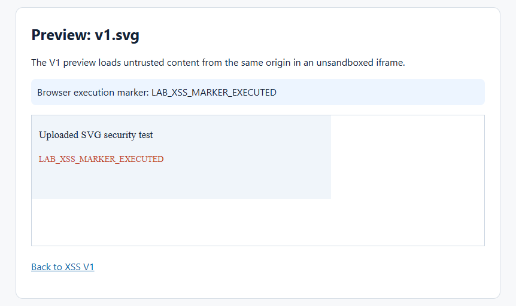
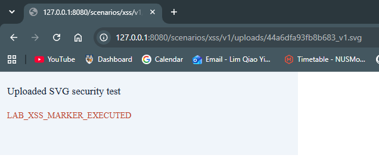
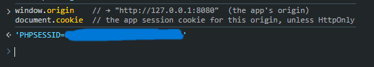

# XSS — V1 (vulnerable baseline)

- **Scenario / target version:** XSS / v1
- **Date:** 2026-11-05
- **Attacker / uploader:** crosley
- **Victim:** arcie (a *different* authenticated user)
- **Input:** [`exploits/xss/v1.svg`](../exploits/xss/v1.svg) — SVG with inline `<script>` that flips a marker
- **Method:** manual (browser; script execution cannot be judged by curl)

## Observed security impact

Two distinct observations:

1. **Self-preview (weaker):** As Crosley, the in-app Preview
   (`preview.php`) flipped the hosting page's `#xss-status` element to
   `Browser execution marker: LAB_XSS_MARKER_EXECUTED`. The script reached the
   *parent* page via `window.parent.document`, proving same-origin, unsandboxed
   execution — but Preview is owner-only, so this is self-XSS.

2. **Cross-victim stored XSS (the real impact):** Logged in as **Arcie**, opening
   Crosley's file at its raw stored path
   `/scenarios/xss/v1/uploads/<stored>.svg` rendered a bare SVG whose script
   executed in Arcie's session. DevTools console on that page:

   ```js
   window.origin    // "http://127.0.0.1:8080"  (the application's origin)
   document.cookie  // "PHPSESSID=<redacted>"   (session cookie is NOT HttpOnly)
   ```

   Because `document.cookie` is readable, this XSS can exfiltrate Arcie's session
   cookie and hijack her account — not just change a marker.

## Screenshots

- Self-preview (Crosley, owner-only `preview.php`): 
- Cross-victim raw URL (Arcie opens Crosley's file at its raw `uploads/` path; bare SVG, no app chrome): 
- Console on the raw page — app origin, and session cookie readable (PHPSESSID value redacted): 

## Root cause

- Uploaded SVGs are stored under the web root and served from the application's
  **own origin** as active content (SVG with inline script).
- The raw `uploads/` path is served by Apache as a static file with **no
  ownership check** and no login gate, so any user can trigger another user's
  uploaded script.
- No sandbox (`sandbox` iframe / separate origin), no
  `Content-Disposition: attachment`, and no Content-Security-Policy.
- Session cookie lacks the `HttpOnly` flag, enabling cookie theft via the XSS.

## Defence applied

None (vulnerable baseline). Planned: V2 safe file delivery (attachment / neutral
type / isolated origin), V3 Content-Security-Policy. Setting `HttpOnly` on the
session cookie should also be recommended.

## Outcome

**VULNERABLE.** Attacker-controlled script executes in the app origin in a
different victim's authenticated session, with the session cookie exposed.

## Legitimate-function check

A benign uploaded file still previews/downloads normally for its owner —
ordinary file sharing is unaffected.
